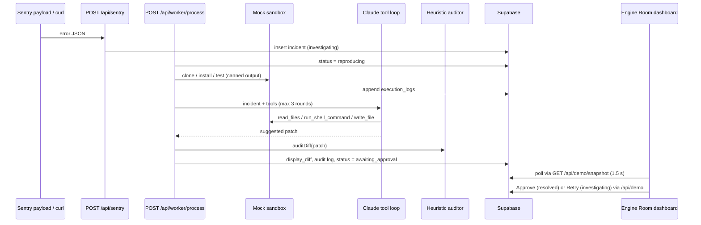

> **Archived hackathon demo (Felicis hackathon, March 2026, 2nd place). Active development continues in [traceback-ai](https://github.com/MaximusAnax/traceback-ai).**

# TraceBack AI: hackathon demo

This is the hackathon vertical slice of an AI debugging agent. It ingests an error payload, runs a Claude tool-use loop against a mock sandbox, audits the proposed patch, and holds the result for human approval in a live "Engine Room" dashboard.

## What it does

1. **Ingest.** `POST /api/sentry` accepts a Sentry-like JSON payload, extracts an issue ID and a summary from varied payload shapes, and creates an `incidents` row in Supabase.
2. **Process.** `POST /api/worker/process` drives the incident through its states:
   - It starts a **mock sandbox** that returns canned `git clone`, `npm install` and `npm test` output and writes each step to `execution_logs`.
   - It runs a **Claude tool-use loop** (Anthropic Messages API) with three tools, `read_files`, `run_shell_command` and `write_file`, all backed by the mock sandbox. The loop is capped at 3 rounds.
   - It runs a **heuristic diff audit**: no network and no second model. The audit flags empty diffs, mass deletions and heavy use of `any`.
   - It stores the proposed patch and sets the incident to `awaiting_approval`.
3. **Review.** The Engine Room (`/dashboard?incident=<uuid>`) polls every 1.5 s and shows a status stepper, the live log terminal and the diff, with **Approve** and **Retry** buttons.

## Flow



## Tech stack

- Next.js 16 (App Router), React 19, TypeScript, Tailwind CSS 4
- Anthropic SDK (`@anthropic-ai/sdk`). The default model is `claude-sonnet-4-20250514`, and `ANTHROPIC_MODEL` overrides it.
- Supabase Postgres (`@supabase/supabase-js`) for incidents and logs
- Optional: `full-product/`, a Python CrewAI loop (Tech Lead prompt, human implements in Cursor, QA audit) for the full build plan

## Quickstart

Prerequisites: Node.js 20.9+ (required by Next.js 16), npm, a Supabase project and an Anthropic API key.

```bash
npm install
cp .env.example .env
# Apply supabase/schema.sql in the Supabase SQL editor
npm run dev            # http://localhost:3000
```

Other scripts: `npm run build`, `npm run start`, `npm run lint`, `npm run typecheck`.

### Environment variables

| Variable | Required | Purpose |
|----------|----------|---------|
| `SUPABASE_URL` | Yes | Supabase project URL |
| `SUPABASE_ANON_KEY` | Yes | Supabase anon key |
| `ANTHROPIC_API_KEY` | For a real run | Claude fix loop. Without it, the worker uses a static fallback patch so the demo still completes |
| `SENTRY_WEBHOOK_SECRET` | No | If set, the `sentry-hook-signature` header must equal it. This is a literal string compare, not an HMAC |
| `ANTHROPIC_MODEL` | No | Overrides the default Claude model |
| `DEMO_REPO_URL` | No | Repo URL shown in the mock clone output (default `https://github.com/demo/traceback-ai`) |

Next.js reads `.env` at startup, so restart `npm run dev` after editing it.

### Run the demo end to end

Use single-line commands. A broken `\` continuation makes curl treat leftover tokens as extra URLs, which shows up as `curl: (3) URL rejected`.

```bash
# 1. Create an incident and note the returned incident_id
curl -sS -X POST "http://localhost:3000/api/sentry" -H "Content-Type: application/json" -d '{"data":{"issue":{"id":"demo-1"},"event":{"message":"Demo error"}}}'

# 2. Run the worker on it
curl -sS -X POST "http://localhost:3000/api/worker/process" -H "Content-Type: application/json" -d '{"incident_id":"YOUR_INCIDENT_UUID"}'

# 3. Open the Engine Room in a browser:
#    http://localhost:3000/dashboard?incident=YOUR_INCIDENT_UUID
```

If `SENTRY_WEBHOOK_SECRET` is set, add `-H "sentry-hook-signature: <same value>"` to step 1. If you get `{"error":"Failed to create incident"}`, check the dev server log for `sentry ingest:` and make sure `supabase/schema.sql` has been applied.

### API

| Method | Path | Body or query | Result |
|--------|------|---------------|--------|
| `POST` | `/api/sentry` | Sentry-like JSON | `{ incident_id }` |
| `POST` | `/api/worker/process` | `{ incident_id }` | `{ ok, incident_id, audit, fix_loop_rounds }` |
| `GET` | `/api/demo/snapshot` | `?incident_id=` | `{ ok, incident, logs }` |
| `POST` | `/api/demo/approve` | `{ incident_id, display_diff? }` | Sets `resolved` |
| `POST` | `/api/demo/retry` | `{ incident_id }` | Sets `investigating` |

## Project structure

```
app/
  api/sentry/            ingest route
  api/worker/process/    sandbox -> Claude loop -> audit -> awaiting_approval
  api/demo/              snapshot, approve, retry
  dashboard/             Engine Room UI (polling)
lib/
  agents/brain.ts        Claude tool-use loop (3 rounds max, static fallback)
  agents/auditor.ts      heuristic diff audit
  services/sandbox-mock.ts  canned sandbox that writes execution logs
supabase/
  schema.sql             incidents + execution_logs
  mutations.ts           typed client and queries
full-product/            optional CrewAI orchestrator for the full build plan
DEMO.md                  detailed demo behavior and API reference
PRD.md, TDD.md           product and technical vision (broader than this demo)
demo_tasks.json          ordered build checklist used during the hackathon
```

## Status and limitations

This repo is archived and kept as the hackathon record. It is a demo, not a working fixer:

- **The sandbox is mocked.** No repository is cloned and no tests run. Every tool returns canned output, so Claude reasons over a simulated workspace.
- **The patch is not applied.** The stored "diff" is Claude's final text response, or a static fallback patch. Approve marks the incident `resolved` and does not open a PR.
- **Retry only resets status.** Retry sets the incident back to `investigating`. You must call `/api/worker/process` again yourself.
- **Webhook security is a placeholder.** The signature check is a literal header compare, and the routes have no auth.
- **There are no automated tests.**

[traceback-ai](https://github.com/MaximusAnax/traceback-ai) replaces the mock pieces with HMAC-verified webhooks, a BullMQ/Redis queue, Cursor SDK agents, an E2B-first reproduction step and an evidence gate.

## License

[MIT](LICENSE)
